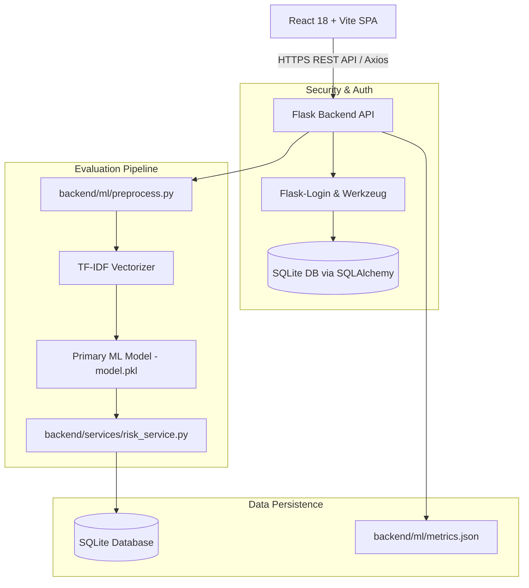

# Fake Job Detection System
**AI & Machine Learning Powered Recruitment Risk Assessment System**  
*MCA Final Year Academic Project*

---

## Overview

The **Fake Job Detection System** is a full-stack, machine learning-driven web application designed to protect job seekers from online recruitment fraud, phishing schemes, and unauthorized payment solicitations. Users can input or paste job advertisement details to receive instant machine learning classifications (Genuine vs. Suspicious), a 0–100 risk score, a probability breakdown, and an itemized list of risk indicators.

> [!IMPORTANT]
> **AI Risk Assessment Disclaimer**: All outputs generated by this system represent AI-based statistical risk assessments and automated risk indicators only. Outputs do not constitute legal proof of fraud or legal determination. Always verify job offers independently with official employer representatives.

---

## Problem Statement

With the rapid expansion of digital employment platforms, online job portals increasingly harbor fraudulent postings created by malicious actors. These scam advertisements aim to:
1. Solicit unauthorized advance fees (e.g., registration fees, security deposits, training kit payments).
2. Harvest sensitive personal and financial data for identity theft.
3. Conduct wire transfer or money-laundering schemes disguised as remote work.

Manual identification of these listings is extremely difficult due to the volume of online ads. This project provides an automated, scalable solution combining Natural Language Processing (NLP), supervised machine learning algorithms, and heuristic risk scoring to flag fraudulent postings before applicants engage.

---

## Key Project Objectives

1. **Automated Fraud Detection**: Provide real-time classification of job advertisements using Natural Language Processing.
2. **Dual-Model Benchmarking**: Train and evaluate both **Logistic Regression** and **Random Forest** algorithms, dynamically selecting the model with the higher F1-score as the primary classifier.
3. **Hybrid Risk Scoring**: Combine ML text probability with a rule-based engine that penalizes fee requests, domain mismatches, short descriptions, and missing corporate assets to calculate a 0–100 risk score.
4. **Empirical Metrics Persistence**: Store true evaluation metrics in `backend/ml/metrics.json` at training time to prevent metric fabrication in the UI.
5. **Data Privacy & Security**: Enforce user history isolation and server-side role-based access control (RBAC).
6. **Analytics Dashboard**: Provide interactive charts (Recharts) for user evaluation trends and risk breakdowns.
7. **Admin Control & Dataset Management**: Equip administrators with dataset CSV upload validation and system-wide monitoring tools.

---

## Key Features

- **Instant Risk Analysis**: Paste 13 standard job posting fields to receive a verdict, confidence percentage, 0-100 risk score, and risk level (Low, Medium, High).
- **Itemized Risk Factors**: View specific reasons for risk penalties (e.g., suspicious terms like "wire transfer", free webmail contacts, salary/experience anomalies).
- **Positive Trust Checklist**: Highlights legitimate signals such as verified logos, extensive requirements, and detailed corporate overviews.
- **Personal Evaluation History**: Paginated, searchable, and filterable history table scoped strictly to the logged-in user.
- **Interactive Analytics Dashboard**: Visualizes Genuine vs. Fake ratios, risk level distributions, 30-day evaluation trends, and top flagged keywords using Recharts.
- **Admin Dataset CSV Validator**: Validate and upload new dataset CSV files with automated column checking and fraudulent value validation.
- **Model Performance Inspector**: View side-by-side evaluation metrics, active classifier status, and confusion matrices.

---

## Tech Stack

| Layer | Technology |
| :--- | :--- |
| **Frontend** | React 18, Vite, Tailwind CSS, Recharts, React Router v6, Axios, Lucide Icons |
| **Backend** | Python 3.11+, Flask, Flask-CORS, Flask-Login, Flask-SQLAlchemy |
| **Machine Learning** | scikit-learn (TF-IDF Vectorizer, Logistic Regression, Random Forest), pandas, numpy, joblib |
| **Database** | SQLite via SQLAlchemy ORM (PostgreSQL-ready schema) |
| **Authentication** | Session-based authentication via Flask-Login & Werkzeug password hashing |

---

## System Architecture



---

## ML Methodology

1. **Text Preprocessing (`backend/ml/preprocess.py`)**:
   - Lowercasing, HTML tag stripping, URL/email removal, non-alphanumeric filtering, whitespace collapse, and stopword removal.
   - Combines `title`, `company_profile`, `description`, `requirements`, `benefits`, `industry`, `function` into one text feature.
2. **Feature Extraction**:
   - `TfidfVectorizer(max_features=5000, ngram_range=(1,2), min_df=1)` converts unstructured text into numerical vector matrices.
3. **Model Training & Comparison (`backend/ml/train_model.py`)**:
   - Evaluates **Logistic Regression** (`class_weight='balanced'`) vs. **Random Forest Classifier**.
   - Computes Accuracy, Precision, Recall, F1-Score, and Confusion Matrix on an 80/20 train/test split.
   - Selects the model with the higher F1-score as the primary classifier.
4. **Serialization**:
   - Saves `model.pkl`, `vectorizer.pkl`, and `metrics.json` to `backend/ml/`.

---

## Dataset Information

- **Primary Dataset**: EMSCAD (Employment Scam Aegean Dataset) containing ~17,880 real-world job advertisements.
- **Demo Fallback Dataset**: If `dataset/fake_job_postings.csv` is absent, the system automatically uses `dataset/demo_dataset.csv` (~300 synthetic rows, ~5% fraud imbalance) and prints a loud warning.
- **Swapping Datasets**: Place any compatible CSV dataset into `dataset/fake_job_postings.csv` or upload it via the Admin Panel.

---

## Installation & Setup Guide

### 1. Prerequisites
- Python 3.11+
- Node.js v18+ & npm v9+

### 2. Backend Setup
```bash
# Navigate to backend directory
cd backend

# Create & activate virtual environment (optional)
python -m venv venv
# On Windows: venv\Scripts\activate

# Install dependencies
pip install -r requirements.txt

# Create .env from template
cp .env.example .env
```

### 3. Frontend Setup
```bash
# Navigate to frontend directory
cd frontend

# Install Node dependencies
npm install
```

---

## How to Train the Model & Seed Database

```bash
# 1. Generate demo dataset (if full EMSCAD is not present)
python dataset/generate_demo_dataset.py

# 2. Train ML models & serialize artifacts
python backend/ml/train_model.py

# 3. Initialize SQLite database & seed Admin user
python backend/database/seed.py
```

---

## How to Run Both Servers

### Terminal 1: Backend Server
```bash
python backend/app.py
# Server runs at http://127.0.0.1:5000
```

### Terminal 2: Frontend Dev Server
```bash
cd frontend
npm run dev
# App runs at http://localhost:5173
```

---

## API Documentation

### 1. Register User
- **Endpoint**: `POST /api/register`
- **Request Body**:
  ```json
  {
    "username": "johndoe",
    "email": "john@example.com",
    "password": "Password123!"
  }
  ```
- **Response** (`201 Created`):
  ```json
  {
    "message": "User registered successfully.",
    "user": { "id": 2, "username": "johndoe", "email": "john@example.com", "role": "user" }
  }
  ```

### 2. Evaluate Job Posting Risk
- **Endpoint**: `POST /api/predict` (Requires Login)
- **Request Body**:
  ```json
  {
    "title": "Data Entry Assistant - $5000/Week",
    "company_profile": "",
    "description": "Work 1 hour daily processing wire transfers and cashing checks. Contact via Telegram.",
    "requirements": "No experience needed. Pay $50 application fee.",
    "benefits": "Instant cash",
    "has_company_logo": false
  }
  ```
- **Response** (`201 Created`):
  ```json
  {
    "id": 1,
    "prediction": "Suspicious",
    "confidence_score": 82.36,
    "risk_score": 88.5,
    "risk_level": "High",
    "risk_factors": [
      { "factor": "Suspicious Keywords Detected", "points": 25.0, "explanation": "Found terms: wire transfer, telegram, fee." }
    ],
    "positive_indicators": []
  }
  ```

### 3. Model Metrics
- **Endpoint**: `GET /api/metrics`
- **Response** (`200 OK`):
  Reads directly from `backend/ml/metrics.json`.

---

## Screenshots & UI Walkthrough

*(Insert UI screenshots here)*
- **Hero Section**: `[Screenshot: Home Page]`
- **Job Analysis Form**: `[Screenshot: Job Form]`
- **Assessment Results**: `[Screenshot: Risk Score Gauge & Factors]`
- **Analytics Dashboard**: `[Screenshot: Recharts Dashboard]`
- **Admin Panel**: `[Screenshot: Admin CSV Uploader & Model Performance]`

---

## Model Evaluation

Evaluation metrics are computed dynamically at training time and saved to `backend/ml/metrics.json`. Refer to the Admin Panel or `GET /api/metrics` for live numbers.

---

## Limitations

1. **Language Scope**: Optimized for English language postings.
2. **Dataset Bias**: Model predictions reflect historical training data patterns.
3. **Heuristic Nature**: Risk scores are indicators, not legal determinations of fraud.

---

## Future Scope

- Deep Learning integration (BERT / Transformer embeddings).
- Real-time browser extension for automatic portal monitoring.
- Official corporate WHOIS domain and email verification APIs.
- Multilingual job evaluation support.
- Mobile application (React Native).

---

## Project Team & Credits

- **Project Lead**: MCA Final Year Student
- **Institution**: Department of Computer Applications
- **Advisor**: Project Supervisor
